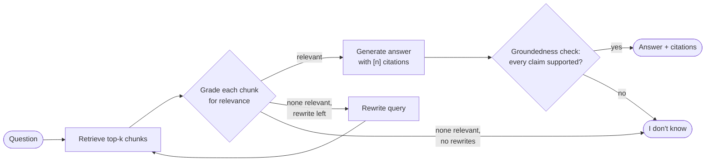

# Llama Agentic RAG

**Self-correcting, citation-grounded RAG on local Llama models, with a built-in evaluation harness, a FastAPI service and an MCP server.**

[](https://github.com/abuzar18/llama-agentic-rag/actions/workflows/ci.yml)


Most RAG demos answer every question confidently, even when the documents say nothing about it. This project is built around the opposite rule: **an answer must be supported by cited sources, or the system says "I don't know"**, and an evaluation suite measures how well it keeps that promise.

It is designed to run fully locally on a consumer GPU (Llama 3.1 8B through Ollama fits in 8 GB of VRAM), so private documents never leave the machine.

## How it works



| Stage | What it does | Why it matters |
|---|---|---|
| Retrieve | Vector search over chunked documents with chunk-level ids | Precise, traceable sources |
| Grade | The LLM judges each chunk's relevance before generation | Off-topic context never reaches the answer |
| Rewrite | One query rewrite when nothing relevant is found | Recovers from vague questions |
| Generate | Answer only from numbered context, citing `[n]` | Every sentence maps back to a chunk |
| Groundedness check | A judge model verifies the answer against the context | Hallucinations become refusals, not wrong answers |

Small models such as Llama 3.1 8B are unreliable with complex JSON schemas, so verdict prompts ask for one-word answers and parsing is tolerant. `<think>` blocks from reasoning models are stripped automatically.

## Quickstart

```bash
# 1. Local models
ollama pull llama3.1:8b
ollama pull nomic-embed-text

# 2. Install
python -m venv .venv && source .venv/bin/activate
pip install -e ".[dev]"

# 3. Index the sample documents (or point RAG_DOCS_DIR at your own .md/.txt files)
python -m agentic_rag.ingest

# 4. Serve
uvicorn agentic_rag.api:app --port 8000
```

```bash
curl -s localhost:8000/ask -H 'content-type: application/json' \
  -d '{"question": "What is required before changing a production prompt?"}'
```

```json
{
  "answer": "...an evaluation run on the regression test set and approval from a second engineer [1].",
  "citations": ["security-and-ai-policy.md#2"],
  "grounded": true,
  "steps": ["retrieve(4)", "grade(2/4)", "generate", "grounded(yes)"]
}
```

Or run everything in Docker (GPU optional):

```bash
docker compose up -d
docker compose exec ollama ollama pull llama3.1:8b
docker compose exec ollama ollama pull nomic-embed-text
```

## Use it from Claude (MCP)

The same graph is exposed as an MCP tool, `ask_documents`, so Claude Desktop, Claude Code or any MCP client can query your documents with citations. Add this to your MCP client config:

```json
{
  "mcpServers": {
    "llama-agentic-rag": {
      "command": "python",
      "args": ["-m", "agentic_rag.mcp_server"],
      "cwd": "/path/to/llama-agentic-rag"
    }
  }
}
```

## Evaluation

`evals/dataset.jsonl` holds labelled questions, including **unanswerable ones**, because a RAG system that never says "I don't know" is not production-ready.

```bash
python -m evals.run_eval            # writes evals/results/report.md and results.json
```

| Metric | Meaning |
|---|---|
| `retrieval_hit_rate` | Answerable questions where an expected source was retrieved |
| `citation_precision` | Cited chunks that come from an expected source |
| `refusal_accuracy` | Unanswerable questions correctly refused |
| `false_refusal_rate` | Answerable questions wrongly refused |
| `judge_correctness` | LLM-as-judge score against the reference answer (0 to 1) |
| `latency_p50_ms` / `p95` | End-to-end latency |

Run the evaluation on your hardware and commit the generated `evals/results/report.md` to track quality over time. Treat prompt or model changes like code changes: they ship only if the evals hold.

## Project layout

```
agentic_rag/
  core.py        settings (env vars, RAG_ prefix) and model factories
  ingest.py      loading, chunking with stable chunk ids, persisted vector index
  graph.py       LangGraph workflow: retrieve, grade, rewrite, generate, groundedness check
  api.py         FastAPI service: /ask, /ingest, /health
  mcp_server.py  MCP server exposing the ask_documents tool
evals/           labelled dataset, metrics and LLM-as-judge harness
tests/           offline tests with fake LLM and embeddings (no GPU needed in CI)
data/docs/       fictional sample handbook and policy documents
```

## Engineering notes

- **Offline, deterministic tests.** CI runs the full graph with scripted fake LLM replies and deterministic embeddings, covering the happy path, query rewrite, refusal, ungrounded answers, missing citations and reasoning-tag stripping.
- **Config over code.** Every model, path and threshold is an environment variable, so swapping Llama 3.1 for another Ollama model is a one-line change.
- **Fail safe.** Backend errors return `503` with a clear message. Uncited or unsupported answers are replaced with a refusal.

## Roadmap

- [ ] Hybrid retrieval (BM25 + vectors) and a cross-encoder reranker
- [ ] Persistent vector database (pgvector or Qdrant)
- [ ] Tracing with Langfuse
- [ ] Streaming responses
- [ ] PDF and DOCX ingestion

## License

MIT. Built by [Abuzar Zulfiqar](https://abuzar18.github.io/), AI/ML engineer.
